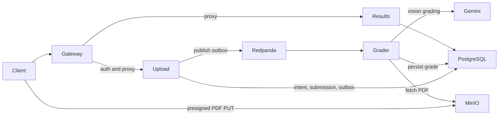

# AI Grader

An event-driven AI exam grader built as a TypeScript monorepo. The architecture and implementation checklist are in [docs/ARCHITECTURE.md](docs/ARCHITECTURE.md) and [docs/PLAN.md](docs/PLAN.md).



## Prerequisites

- Node.js 22 or later and npm
- Docker with the Compose plugin

## Local infrastructure

Copy `.env.example` to `.env` to configure the local-only defaults, then start the dependencies:

```sh
Copy-Item .env.example .env
docker compose up -d
docker compose ps
```

Services:

- PostgreSQL: `localhost:5432`
- Redpanda Kafka API: `localhost:19092` (internal Compose address: `redpanda:9092`)
- MinIO S3 API: `localhost:9000`; console: `http://localhost:9001`
- MinIO bucket: `ai-grader-submissions` (created automatically by the one-shot `minio-init` container)

The checked-in example credentials are for local development only. Do not use them in shared or production environments. `.env.example` uses host-accessible endpoints for running Node.js directly; when app containers are introduced, they must use the Compose service hostnames (`postgres`, `redpanda`, and `minio`).

The local Compose setup currently uses the archived `bitnamilegacy/minio` image to provide MinIO-compatible development storage. It is for local prototyping only; select a currently supported MinIO distribution before using this setup outside local development. `S3_ENDPOINT` is the address used by app containers (`http://minio:9000`); `S3_PRESIGN_ENDPOINT` must be reachable by the client receiving the presigned URL (default `http://localhost:9000` for local development).

Before running the grader, set `GEMINI_API_KEY`, `GEMINI_MODEL`, and `GRADING_RUBRIC` in `.env` to valid values. The grader sends rendered answer-sheet pages and the rubric to the configured Gemini model. Google AI Studio free-tier quotas and model availability vary, and Google may use free-tier content to improve its products; avoid sending sensitive student data unless the applicable privacy terms and consent allow it.

Check that PostgreSQL accepts a query:

```sh
docker compose exec -T postgres psql -U grader -d grader -c "SELECT 1;"
```

MinIO's console is available at `http://localhost:9001` with the local root credentials from `.env`.

Apply the database migrations after the local PostgreSQL service is healthy:

```sh
npm run db:migrate
npm run kafka:create-topics
```

## Workspace

Install the workspace dependencies and build or type-check all packages:

```sh
npm install
npm run build
npm run typecheck
```

To verify the gateway imports the shared package and connects to PostgreSQL on startup:

```sh
npm run start --workspace=@ai-grader/gateway
```

The gateway reads `.env` from the repository root. `UPLOAD_SERVICE_URL` and
`RESULTS_SERVICE_URL` configure gateway proxy destinations. For local host
development, start services in separate terminals after building:

```sh
npm run start --workspace=@ai-grader/upload
npm run start --workspace=@ai-grader/grader
npm run start --workspace=@ai-grader/results
npm run start --workspace=@ai-grader/gateway
```

The grader requires a usable Google AI Studio API key, enabled model ID, and grading rubric.
Without them it will fail configuration validation or provider requests rather
than silently return a made-up grade. For a local Docker run in PowerShell, the
sample rubric can be supplied to Compose without putting its contents in source
control:

```powershell
$env:GEMINI_MODEL = "gemini-2.5-flash"
$env:GRADING_RUBRIC = Get-Content samples\rubric.md -Raw
docker compose up -d --build
```

## Run the full system in Docker

Set `GEMINI_API_KEY`, `GEMINI_MODEL`, and `GRADING_RUBRIC` in `.env` before
starting the grader. `GEMINI_MODEL=gemini-2.5-flash` is the model used by the
live local verification; model access and quotas depend on the Google AI Studio
account. The rubric should describe the marking criteria and the expected
maximum score.

Build and start PostgreSQL, Redpanda, MinIO, the one-shot migration/topic setup,
and all four services:

```sh
docker compose up -d --build
docker compose ps
```

The gateway is available at `http://localhost:3000`. Container-to-container
traffic uses Compose hostnames, and health checks gate service startup on the
database, broker, and downstream APIs. Stop any host-run APIs first to avoid
port conflicts. To stop the stack without removing persisted data, run
`docker compose down`.

## API

All client requests go through the gateway on port 3000:

- `POST /auth/register`, `POST /auth/login`, `POST /auth/refresh`, and `GET /auth/me`
- `POST /uploads/presign` and `POST /uploads/{uploadIntentId}/complete`
- `GET /results` and `GET /results/{submissionId}`

Request and response shapes, authorization requirements, and status codes are
documented in [docs/API.md](docs/API.md).

## Design decisions

- **Transactional outbox:** submission creation and its event are committed
  together. The publisher can safely retry unsent events after broker outages.
- **Kafka/Redpanda:** grading runs asynchronously, separate from upload request
  latency. Consumers assume at-least-once delivery and use database idempotency
  to avoid duplicate grades.
- **Presigned uploads:** PDF bytes go from the client directly to object storage;
  the API does not proxy large file bodies or expose the user's JWT to MinIO.
  Completion checks object metadata and the PDF signature before queuing work.
- **Gemini structured output:** the vision model receives rendered page images
  and a rubric; its JSON is validated locally before persistence, and malformed
  grade output is retried once.

## Known limitations

- AI grades are not a substitute for instructor review. The sample grading
  flow is a prototype and has not been calibrated for high-stakes use.
- Gemini free-tier model access and quotas vary. Google may use free-tier
  content to improve its products; do not send identifiable or sensitive exam
  data unless the privacy terms and required consent permit it.
- Uploads are limited to 10 MiB and the presigned PUT URL does not enforce the
  size limit during transfer; completion rejects oversized objects afterward.
- Access and refresh tokens are stateless; there is no token revocation store.
- The local MinIO Compose image is archived and intended only for prototyping.

## Tests

With PostgreSQL, Redpanda, MinIO, and the migration schema available:

```sh
npm test
```

API paths and request/response examples are documented in [docs/API.md](docs/API.md).
To run the upload service directly after building the workspace, use:

```sh
npm run build --workspace=@ai-grader/upload
npm run start --workspace=@ai-grader/upload
```

The upload API listens on `http://localhost:3001` by default. It validates and
completes upload intents, writes submissions and outbox events transactionally,
and publishes those events to Redpanda. The gateway proxies upload and results
routes while the downstream services independently verify access tokens.
